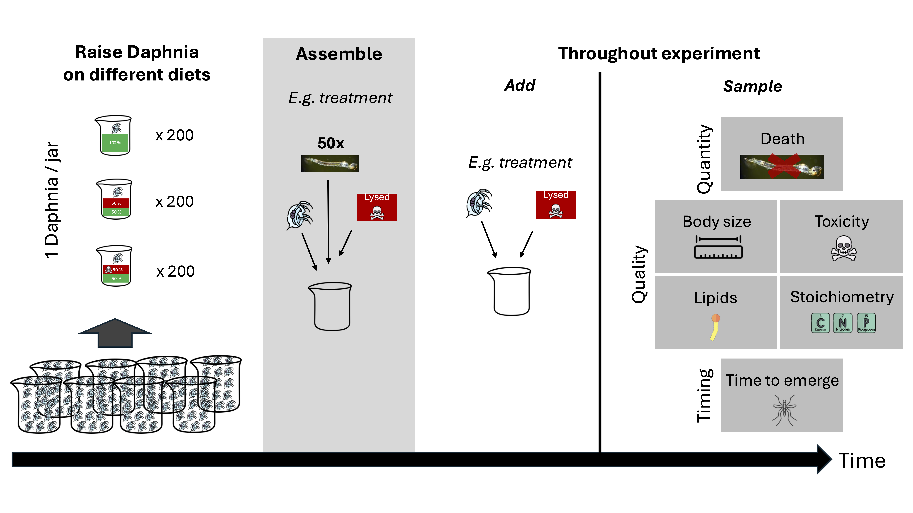

# Experimental Design

## Aim

The aim of this experiment is to investigate how cyanobacteria affect the predator *Chaoborus* through changes in the quality and toxicity of its prey, *Daphnia magna* (Figure 1). 

## Treatments

*Daphnia* are raised on one of four diets, fully crossing toxicity and food quality (Figure 1).

  

<strong>Figure 1.</strong> Experimental design.

## Understanding the effects of food quality

Food is always provided **ad libitum**, meaning that the predator (*Chaoborus*) is provided across treatments with the same amount of carbon and the difference between diets is due to the quality or toxicity of preys rather than from the amount of food provided. **We need to make sure that throghout the experiment Chaborus is never without prey.**

## Measurements

The experiment measures three dimensions of the effects of cyanobacteria on the emergence of *Chaoborus*: **quantity**, **quality**, and **timing**. **The following measurements are performed only on emerged (winged adult) individuals.** 

### Quantity
- ❌ **Survival**
  - Number of emerged individuals.
  - Biomass of emerged inviduals *(TODO: discuss with Jana if it's possible to determine biomass before analysing samples)* 

### Quality
- 💊 **Essential lipids**
  - PUFAs and sterols analysed using **Gas Chromatography**.
- 🔲 **Stoichiometry**
  - Nutrient analysis *(method to be added)*.
- 📏 **Body size**
  - Photograph individuals for body size measurements *(method under development)*.
- ☠️ **Toxicity**
  - Cyanotoxin concentration measured using **ELISA**.

### Timing
- 🌳 **Emergence**
  - Number of emerged individuals.

> [!NOTE]
> Quality and timing measurements are performed **only on individuals that are alive at the end of the experiment**.

All treatments receive the same amount of carbon, allowing differences among treatments to be attributed to food quality and toxicity rather than food quantity. The experiment is conducted in complete darkness to prevent phytoplankton growth during the experiment, and each treatment consists of four independent replicates. Throughout the experiment, measurements of *Chaoborus* survival, emergence, body size, stoichiometry, fatty acid and sterol composition, and cyanotoxin concentrations are collected to determine how prey quality influences the quantity, quality, and timing of resource transfer. We will give the same amount of carbon to all the treatments. We will have four replicates.

*Daphnia* are first raised on their assigned diet in individual jars (1 *Daphnia* per jar, ~200 jars per diet) to build up the stock needed for the experiment. At assembly, replicates are set up by adding *Chaoborus* larvae together with *Daphnia* prey into individual containers; for the treatment isolating cyanotoxin effects, lysed *Microcystis aeruginosa* is added directly to the container at this stage rather than being part of the *Daphnia* diet. Throughout the experiment, *Daphnia* (and, where relevant, lysed *Microcystis*) are replenished to maintain ad libitum feeding, while samples are collected to track three types of end points over time: quantity (survival/death), quality (body size, cyanotoxin content, lipid composition, and elemental stoichiometry), and timing (time to emergence).

  

<strong>Figure 2.</strong> Timeline of the experiment.

---

## Overview

About a month before the assembly of the experiment, the basal resources and preys are raised.

## *Chaoborus*

**Initial conditions.** *Chaoborus* will be sourced in the form of third-instar larvae *(add the size of the larvae and references that say that's a third instar)* from IT-Ichthyo Trophic, Poland. The initial population density of *Chaoborus* will be 10, which is above what needed for all the different analyses (4.5 mg, see [Box 1: Sample Collection and Storage](protocols/sample_collection_and_storage.md)). This larval density, which below 50 individuals per jar (9 cm diameter) corresponds to ~8,000 individuals m⁻², which falls within the upper range of peak natural *Chaoborus* densities reported from eutrophic, fish-free systems (Xie et al., 1998). *Chaoborus* will be fed ad libitum by providing them with 10 Daphnia of 1 to 5 days old (see [Box 1: Sample Collection and Storage](protocols/sample_collection_and_storage.md)).

**Measurements.** At the beginning of the experiment and through the experiment we will be measuring end points telling us about the quantity, quality, and timing of resource flows (see Table 2). We will pull larvae, pupae, and adults together, recording the number of larvae, pupae, and adults. During this, we will also be taking out all the extra Daphnia in the jars *(add whether should we do this every day or every time we change the medium of Chaoborus)*. Also, we will need to measure the ones at the beginning as well. See Table 2 and [Box 1: Sample Collection and Storage](protocols/sample_collection_and_storage.md).

## End points

> [!NOTE]
> ## Biomass required for analyses
>
> The amount of biomass required for this experiment depends on the analyses to be performed and the expected biodilution of cyanotoxins along the food chain.
>
> ### Analyses requiring biomass
>
> 1. PUFA and sterol analysis
> 2. Stoichiometry analysis
> 3. Toxin analysis (ELISA)
>
> ### Expected biodilution
>
> - **Microcystis aeruginosa:** 0.7–7 mg g⁻¹ DW microcystins.
> - **Daphnia magna:** approximately 80-fold biodilution.
> - **Chaoborus spp.:** approximately 5-fold biodilution from *Daphnia*.
>
> ### ELISA detection limits
>
> - ✅ Abraxis Microcystins-ADDA ELISA Kit — **0.10 µg L⁻¹**
> - ✅ Eurofins Microcystin Plate Kit — **0.05 µg L⁻¹**
> - ✅ Beacon Microcystin ELISA Kit — **0.10 µg L⁻¹**
> - ❌ Envirologix Microcystins Quantiplate Kit — **0.15 µg L⁻¹**
>
> ### Final calculation
>
> Use the biodilution values above together with the ELISA detection limits to estimate the minimum biomass required for each analysis.

