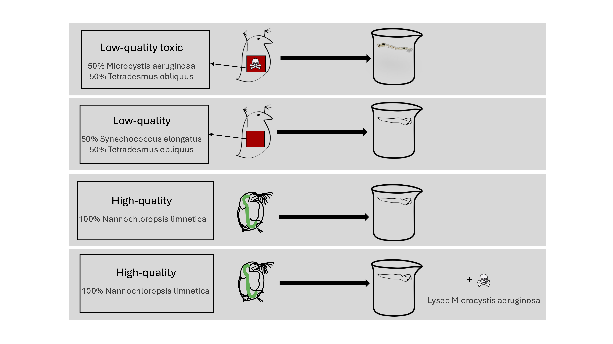

# Experimental Design

Part of [The interactive effects of toxicity and poor food quality of Cyanobacteria via indirect effects on Chaoborus](README.md).

**Figure 1.** Experimental design. The experiment will be in the dark. We will give the same amount of carbon to all the treatments. We will have four replicates.

**Figure 2.** Timeline of the experiment.

| Time | Monday | Tuesday | Wednesday | Thursday | Friday | Saturday | Sunday |
|---|---|---|---|---|---|---|---|
| 8–9 | Make Zoo-COMBO 🫙 | Change Zoo-COMBO 🫙🔁 | Make Zoo-COMBO 🫙 | Change Zoo-COMBO 🫙🔁 | Make Zoo-COMBO 🫙 | Change Zoo-COMBO 🫙🔁 | Make Zoo-COMBO 🫙 |
| 9–10 | | | | | | | |
| 10–11 | Feed Chaoborus 🥪🦟 | | Feed Chaoborus 🥪🦟 | | Feed Chaoborus 🥪🦟 | | Feed Chaoborus 🥪🦟 |
| 11–12 | | | | | | | |
| 12–1 | | | | | | | |
| 1–2 | | | | | | | |
| 2–3 | | | | | | | |
| 3–4 | Prepare Daphnia food 🧪 | | Prepare Daphnia food 🧪 | | Prepare Daphnia food 🧪 | | Prepare Daphnia food 🧪 |
| 4–5 | Feed Daphnia 🥪🦐 | | Feed Daphnia 🥪🦐 | | Feed Daphnia 🥪🦐 | | Feed Daphnia 🥪🦐 |
| 5–6 | Cleaning 🧹 | Prepare Daphnia food 🧪 | Cleaning 🧹 | Prepare Daphnia food 🧪 | Cleaning 🧹 | Prepare Daphnia food 🧪 | Cleaning 🧹 |
| 6–7 | | Feed Daphnia 🥪🦐 | | Feed Daphnia 🥪🦐 | | Feed Daphnia 🥪🦐 | |
| 7–8 | | Cleaning 🧹 | | Cleaning 🧹 | | Cleaning 🧹 | |
| 8–9 | | | | | | | |
| 9–10 | | Make sure there's enough food that it's ad libitum | | Make sure there's enough food that it's ad libitum | | Make sure there's enough food that it's ad libitum | |

*(read directly from the "Hours" tab of `timeline.xlsx`)*

---

## Overview

About a month before the assembly of the experiment, the basal resources and preys are raised.

## Chaoborus

**Initial conditions.** Chaoborus will be sourced in the form of third-instar larvae *(add the size of the larvae and references that say that's a third instar)* from IT-Ichthyo Trophic, Poland. The initial population density of Chaoborus will be 10, which is above what needed for all the different analyses (4.5 mg, see [Box 1: Sample Collection and Storage](protocols/sample_collection_and_storage.md)). This larval density, which below 50 individuals per jar (9 cm diameter) corresponds to ~8,000 individuals m⁻², which falls within the upper range of peak natural Chaoborus densities reported from eutrophic, fish-free systems (Xie et al., 1998). Chaoborus will be fed ad libitum by providing them with 10 Daphnia of 1 to 5 days old (see [Box 1: Sample Collection and Storage](protocols/sample_collection_and_storage.md)).

**Measurements.** At the beginning of the experiment and through the experiment we will be measuring end points telling us about the quantity, quality, and timing of resource flows (see Table 2). We will pull larvae, pupae, and adults together, recording the number of larvae, pupae, and adults. During this, we will also be taking out all the extra Daphnia in the jars *(add whether should we do this every day or every time we change the medium of Chaoborus)*. Also, we will need to measure the ones at the beginning as well. See Table 2 and [Box 1: Sample Collection and Storage](protocols/sample_collection_and_storage.md).

**Table 2.** End points of Chaoborus. Quality and timing will be measured only for alive individuals at the end of the experiment.
*(table content to be added)*

---

See [Culturing organisms](culturing.md) for how the phytoplankton and zooplankton are prepared before the experiment, [Box 1](protocols/sample_collection_and_storage.md) for the sample handling protocol, and the [Bibliography](bibliography.md) for references.
