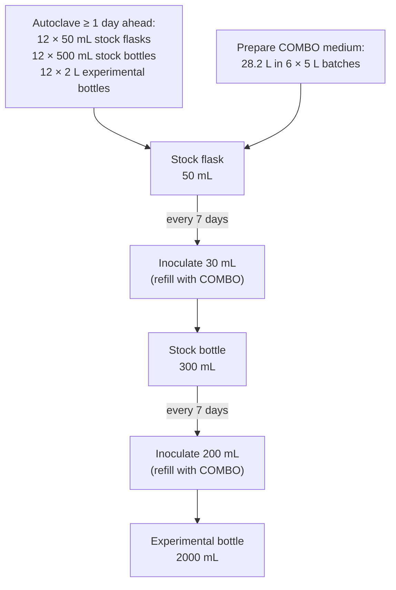

# The effects of Cyanobacteria on quantity, quality, and timing of insect emergence.


<!--
This file stitches the chapters below into a single rendered document
(Rendered_files/README.md and Rendered_files/Rendered.html) so that
numbers computed in one chapter (e.g. Calculations) can be quoted
inline everywhere else, instead of being retyped by hand. The output
is named README.md so GitHub renders it automatically when browsing
into Rendered_files/. Quarto renders to 1_master.md/1_master.html in
this folder by default (do NOT set output-file to README.md directly:
Quarto stages its render at the source-relative filename before any
--output-dir move, which would clobber this folder's own README.md).
To rebuild, run from this folder:
    quarto render 1_master.qmd
    mkdir -p Rendered_files
    mv 1_master.md Rendered_files/README.md
    mv 1_master.html Rendered_files/Rendered.html
Edit the chapters themselves, not this file — this file only decides
the reading order:
    2_overview.qmd                — project introduction (includes the repo README)
    3_parameters.qmd               — shared biomass-per-analysis assumptions, must be
                                       included before 4_calculations.qmd, which uses
                                       them
    4_calculations.qmd             — organism, jar, and infrastructure quantities;
                                       included before 5_experimental_design.qmd and
                                       6_experimental_procedure.qmd, which quote its
                                       numbers inline
    5_experimental_design.qmd      — treatments, Chaoborus setup, end points
    6_experimental_procedure.qmd   — pre-experiment culturing & assembly steps
    7_bibliography.qmd             — references
    8_protocols.qmd                — auto-generated from protocol/, bench SOPs
-->

# Overview of the project

> [!WARNING]
>
> ### 🚧 Work in progress
>
> This document is a live working draft, not a finished protocol —
> please read it with that in mind. The research question, the
> four-treatment diet design, and most sizing calculations (jars,
> cohorts, biomass) are decided, but the experiment itself hasn’t
> started yet. Ongoing work includes phytoplankton growth-rate
> calibration (particularly for *Nannochloropsis limnetica*), toxin
> quantification method/kit selection, and *Chaoborus* sourcing and
> sampling logistics. The experiment’s start date and total duration are
> also still undecided. Sections and numbers below may still change —
> comments and corrections are very welcome.

## 🔬 What’s this project about?

In one sentence: **we’re trying to understand how cyanobacteria affect
the connection between aquatic and terrestrial ecosystems.**

Here’s the longer version:

Freshwater ecosystems, such as ponds, aren’t isolated from the land
around them — they’re constantly exchanging resources with it. One of
the most significant links is **emerging aquatic insects**: insects that
spend their larval life underwater and then emerge as adults, flying out
of the water and into terrestrial systems. When they emerge, they become
food for spiders, birds, bats, and all sorts of land-based predators. In
many ecosystems, this pulse of insects is a huge — and often
irreplaceable — source of energy and nutrients (e.g., Omega-3) for
terrestrial food webs. Cut off that pulse, make it low quality, or shift
when it happens, and you can ripple effects all the way up terrestrial
food webs.

Now bring in **cyanobacteria** (aka “blue-green algae”). Cyanobacterial
blooms are becoming more common worldwide due to warming and nutrient
pollution, and they can mess with aquatic food webs in (at least) two
very different ways:

1.  **Toxins** — many cyanobacteria produce toxins (like microcystins)
    that can directly harm the animals living in the water.
2.  **Poor food quality** — even when they’re not toxic, cyanobacteria
    tend to be nutritionally poor food (they lack certain essential
    fatty acids and other nutrients that animals need to grow and
    reproduce).

The tricky part: these two effects usually happen *at the same time* in
nature, so it’s really hard to know which one is actually driving the
damage. Is it the toxic, or is it the poor quality food effect (or
both)? **Teasing these two mechanisms apart is the central goal of this
project.**

## 🧪 Why Chaoborus?

To study this, we use *Chaoborus* — commonly known as the **phantom
midge** — as our model organism. A few reasons it’s a great fit:

- It’s a genus that’s **widespread around the world**, found in lakes
  and ponds across many continents, so what we learn has broad
  relevance.
- It’s a well-established model in freshwater ecology, so there’s a
  solid foundation of methods and knowledge to build on, and it’s
  (relatively) easy to keep in the lab.

By feeding *Chaoborus* different cyanobacterial diets (toxic
vs. non-toxic, nutritionally varied) and tracking how they grow,
survive, and eventually emerge, we can start to disentangle *toxicity*
from *food quality* — and understand what that means for the animals
waiting on land for their next meal to fly out of the water.

Thanks for stopping by — happy reading, and welcome aboard! 🔬🦟

## 👥 Who’s in this?

This project is powered by a small but very dedicated crew:

| Name | Role | Institution |
|----|----|----|
| Emanuele Giacomuzzo | Creator of this project, postdoc | University of Copenhagen, DK |
| Jana Isanta-Navarro | Professor | University of Copenhagen, DK |
| Kirsten Seestern | Professor | University of Copenhagen, DK |
| Ali Ger | Professor | Federal University of Rio Grande do Norte, Brazil |
| Irma Carvalho | Postdoc | Federal University of Rio Grande do Norte, Brazil |
| Mikael Kosmou | MSc student, writing his MSc thesis on this project | University of Copenhagen, DK |
| Tobias Hoffmann Jensen | BSc student, wrote his BSc thesis on this project | University of Copenhagen, DK |
| Tina Katherine Varis | BSc student, doing research assistanship within this project | Elon University, USA, exchange @ University of Copenhagen, DK |

Basically, a small international team spanning Denmark, Brazil, and the
US, at every career stage from BSc to PI — all digging into the same big
question 🌍

# Parameters & calculations

> [!NOTE]
>
> ### Parameters
>
> ``` r
> # DW = dry weight
>
> # 🌐 General 
>
> Treatments <- 4
> Replicates <- 4
>
> # 🪜 Infrastructure
>
> Shelves <- 16
> Max_weight_per_shelf_kg <- 20
> Small_jar_liquid_litres <- 0.08
> Small_jar_with_liquid_kg <- 0.2
> Large_jar_liquid_litres <- 0.8
> Large_jar_with_liquid_kg <- 1.5
>
> # 🔥 Autoclaving
>
> Autoclave_temperature_C <- 121 # Vana & Claudia defined this, as it's written on the autoclave at the Marine Biology Section, but I'm not sure where they got this from
> Autoclave_solids_minutes <- 25  # Vana & Claudia defined this, as it's written on the autoclave at the Marine Biology Section, but I'm not sure where they got this from
> Autoclave_solids_minutes <- 25 # Vana & Claudia defined this, as it's written on the autoclave at the Marine Biology Section, but I'm not sure where they got this from
> Autoclave_1L_bottle_minutes <- 45 # Vana & Claudia defined this, as it's written on the autoclave at the Marine Biology Section, but I'm not sure where they got this from
> Autoclave_2L_bottle_minutes <- 60 # I always autoclaved COMBO in 2L bottles for this amount of time and never had a problem with it
> Autoclave_5L_bottle_minutes <- 85 # Vana & Claudia defined this, as it's written on the autoclave at the Marine Biology Section, but I'm not sure where they got this from
>
> # 🦟 Chaoborus
>
> Chaoborus_third_instar_DW_mg <- 0.79 # Lowest weight in the following paper: Parma, S. (1971). Chaoborus flavicans (Meigen)(Diptera, Chaoboridae): an autecological study.
> Chaoborus_larvae_per_jar <- 10 # Initial density; below 50 ind./jar (9 cm diameter) this stays within the upper range of natural peak densities (Xie et al., 1998)
> Chaoborus_jar_liquid_litres <- 0.8
> Chaoborus_jar_with_liquid_kg <- 1.5
> Chaoborus_dead_to_alive_ratio_worst_tratment <- 2
> Chaoborus_Daphnia_neonates_eaten_per_day <- 20 #Based on female fourth instar eating 1.25 mm D. magna babies (Büns & Ratte, 1991)
> Chaoborus_Daphnia_neonates_eaten_max_recorded <- 25 # Highest single-feeding count observed
> Chaoborus_cyanotoxin_biodilutin_from_Daphnia <- 5 # Based on a field study where toxins were detected with HPLC/PDA: Sotton, B., Guillard, J., Anneville, O., Maréchal, M., Savichtcheva, O., & Domaizon, I. (2014). Trophic transfer of microcystins through the lake pelagic food web: Evidence for the role of zooplankton as a vector in fish contamination. Science of the Total Environment, 466, 152-163.
>
> # 🦐 Daphnia
>
> Daphnia_adults_per_jar <- 15
> Daphnia_individuals_per_new_cohort_jar <- 10 # Individuals pipetted from stock into each newly created cohort jar (protocol/3_create_Daphnia_jars.md)
> Daphnia_fed_C_mg_per_litre_per_day <- 2 # Applies both to treatment cohort jars (fed the diet mixes above) and to the stock jars that found them (fed *Tetradesmus obliquus* alone, ad libitum, since the stock isn't part of the diet treatments; see 4_calculations.qmd)
> Daphnia_neonates_per_mother_per_5_days <- 20
> Daphnia_max_age_eaten_days <- 5 # Oldest a Daphnia neonate can be while still small enough for Chaoborus to eat
> Daphnia_DW_adult_mg <- 0.18 # Average weight of an individual in the following paper: Simčič, T., & Brancelj, A. (1997). Electron transport system (ETS) activity and respiration rate in five Daphnia species at different temperatures. Hydrobiologia, 360(1), 117-125.
> Daphnia_cyanotoxin_biodilution_from_Microcystis <- 80 # Based on an experiment: Thostrup & Christoffersen, 1999
> Vana_Daphnia_starting_jars <- 2 # Jars available in Vana's stock cultures to start propagation from; placeholder, confirm actual count with Vana
> Propagation_lead_time_days <- 30 # One month, the planned lead time for propagating Daphnia before the experiment starts
>
> # 🧪 Phytoplankton 
>
> Phytoplankton_growth_time_days <- 10
> Phytoplankton_highest_concentration_mg_C_per_litres <- 50 # Based on the fact that M. aeruginosa is the one that grows the worst and that in Thostrup & Christophersen, 1999 grew up to 150, we use 50 to be conservative. Also, Vana told me that her T. obliquus grows at 28-150 mg C / L
> Phytoplankton_low_quality_food_ratio <- 0.5 # I would go for 50% of both Microcystis and Synechococcus compared to Tetradesmus. Feeding Daphnia magna with 50% of Microcystis can keep cultures dense enough to perform experiment (Macke et al., 2017) but still have a negative effect (Schwarzenberger et al., 2012, 2013). Feeding Daphnia magna with 50% of Synechococcus can also keep cultures alive but still have a negative effect (Demott & Müller-Navarra, 1997).
>
> Phytoplankton_species_count <- 4 # M. aeruginosa, S. elongatus, N. limnetica, T. obliquus
> Phytoplankton_vessels_per_species <- 3 # Replicate stock flasks/bottles kept per species at each vessel size; once at experimental scale, these 3 experimental bottles are also what's alternated between for daily Daphnia-feeding harvests (see 4_calculations.qmd)
> Phytoplankton_stock_flask_volume_mL <- 50
> Phytoplankton_stock_flask_inoculation_volume_mL <- 30
> Phytoplankton_stock_bottle_capacity_mL <- 500
> Phytoplankton_stock_bottle_liquid_mL <- 300
> Phytoplankton_stock_bottle_inoculation_volume_mL <- 200
> Phytoplankton_experimental_bottle_volume_mL <- 2000
> Phytoplankton_inoculation_interval_days <- 7
> COMBO_batch_volume_litres <- 5 # Standard batch size per the COMBO protocol (protocol/1_create_COMBO.md)
>
> # 🍽️ Diet treatments (Daphnia raised on each mix before being fed to Chaoborus; Figure 1)
>
> Diet_names <- c("Low-quality toxic", "Low-quality", "High-quality", "High-quality (toxin-spiked)")
>
> # Fraction of each species by carbon in the Daphnia diet for each treatment above, in the same order
> Diet_Microcystis_fraction     <- c(Phytoplankton_low_quality_food_ratio, 0, 0, 0)
> Diet_Synechococcus_fraction   <- c(0, Phytoplankton_low_quality_food_ratio, 0, 0)
> Diet_Nannochloropsis_fraction <- c(0, 0, 1, 1)
> Diet_Tetradesmus_fraction     <- c(1 - Phytoplankton_low_quality_food_ratio, 1 - Phytoplankton_low_quality_food_ratio, 0, 0)
> # The 4th treatment's toxin exposure comes from lysed M. aeruginosa dosed directly into the Chaoborus
> # jar (Figure 1), not through the Daphnia diet, so it adds no Microcystis to the fractions above — see
> # the To do in 4_calculations.qmd about sizing that dose.
>
> # OD-to-carbon calibration curves (mg C/L = slope x OD_480 - intercept), fitted per species from a
> # dilution series read on the spectrophotometer and filtered onto pre-combusted GF/C filters for
> # carbon analysis (method: protocol/quarto/22_2026_03_27_OD_curve_Microcystis.md); used by
> # calculations/food_calculator.qmd to dose Daphnia feeding (see 6_experimental_procedure.qmd)
> Tetradesmus_OD_to_C_slope <- 158.32
> Tetradesmus_OD_to_C_intercept <- -10.991
> Synechococcus_OD_to_C_slope <- 89.419
> Synechococcus_OD_to_C_intercept <- -4.463
>
> # ☠️ Toxins
>
> Microcystins_mg_per_g_DW_phytoplankton <- 1 # In *Microcystis aeruginosa* (strain PCC 7806, grown in N-limited modified MLA medium) depending on growth phase. See Long, B. M., Jones, G. J., & Orr, P. T. (2001). Cellular microcystin content in N-limited Microcystis aeruginosa can be predicted from growth rate. Applied and Environmental Microbiology, 67(1), 278-283. 
> Microcystins_biodilution_factor_Daphnia <- 80 # *Daphnia magna* shows roughly 80-fold biodilution relative to *M. aeruginosa* — about 2 mg g⁻¹ DW in the phytoplankton versus ~0.025 mg g⁻¹ DW in *D. magna* [@thostrup1999].
> Microcystins_biodilution_factor_Chaoborus <- 5 # Based on a field study where toxins were detected with HPLC/PDA: Sotton, B., Guillard, J., Anneville, O., Maréchal, M., Savichtcheva, O., & Domaizon, I. (2014). Trophic transfer of microcystins through the lake pelagic food web: Evidence for the role of zooplankton as a vector in fish contamination. Science of the Total Environment, 466, 152-163. However, the literature reports also total biodilution. @lauren-maatta1995 found no detectable microcystins in *Chaoborus* fed Microcystis-exposed *Daphnia*, though they used HPLC (a comparatively high detection limit) and did not measure toxins in the *Daphnia* themselves; @sotton2014, a field study using HPLC/PDA, found roughly 5-fold biodilution from zooplankton (863 ng g⁻¹ FW) to *Chaoborus* (168 ng g⁻¹ FW); and @riehle2024, using high-resolution LC–MS/MS, detected microcystins in zooplankton (2.5–4.5 µg g⁻¹ DW) but not in *Chaoborus*.
> Microcystins_detection_limit_ug_per_L <- 0.05 # Eurofins Microcystin Plate Kit detects down to 0.05 µg L⁻¹, the Abraxis Microcystins-ADDA ELISA Kit and the Beacon Microcystin ELISA Kit both detect down to 0.10 µg L⁻¹, and the Envirologix Microcystins Quantiplate Kit detects down to 0.15 µg L⁻¹.
> Microcystins_extraction_volume_mL <- 1 # Placeholder — volume each freeze-dried Chaoborus sample will be extracted/reconstituted into before running the ELISA; not yet decided, so confirm against the chosen kit's protocol and update (see To do below).
>
> # ⚖️ Biomass needed for analyses (dry biomass)
>
> Biomass_needed_for_PUFAs_mg <- 1 # Tarn Preet Parmar, personal communication
> Biomass_needed_for_sterols_mg <- 1 # Tarn Preet Parmar, personal communication
> Biomass_needed_for_stoichiometry_mg <- 1.5 # Dominik Martin-Creuzburg, personal communication
> # Biomass_needed_for_toxins_mg is calculated in 4_calculations.qmd from the microcystin biodilution chain, the ELISA detection limit, and Microcystins_extraction_volume_mL above.
> # Biomass_needed_for_P_mg <- ... # The lowest Claudia recorded was 0.005 mg of phosphorus (but she doesn’t know for how much dry weight).
> ```

> [!WARNING]
>
> ### To do
>
> - @ Irma: let’s analyse `Microcystins_mg_per_g_DW_phytoplankton`.
> - Wait for Anne’s answer on how much dry biomass for P analysis →
>   update the amount needed for phosphorus analysis.
> - Wait for kit and protocol for measuring microcystins → check the
>   detection limit and update `Microcystins_detection_limit_ug_per_L`
>   accordingly, as well as `Microcystins_extraction_volume_mL`

> [!NOTE]
>
> ### Calculations
>
> ``` r
> # 🧪 Phytoplankton: culture vessels and COMBO medium
>
> Phytoplankton_vessels_total <- Phytoplankton_species_count * Phytoplankton_vessels_per_species
>
> COMBO_total_litres <- Phytoplankton_vessels_total *
>   (Phytoplankton_stock_flask_volume_mL + Phytoplankton_stock_bottle_liquid_mL + Phytoplankton_experimental_bottle_volume_mL) / 1000
>
> COMBO_batches <- ceiling(COMBO_total_litres / COMBO_batch_volume_litres)
>
> # 🦐 Daphnia: cohort sizing, to cover Chaoborus' worst-case daily appetite
>
> Chaoborus_Daphnia_neonates_needed_per_day <- Chaoborus_larvae_per_jar *
>   Chaoborus_Daphnia_neonates_eaten_max_recorded * Treatments * Replicates
>
> Daphnia_neonates_per_cohort_jar <- Daphnia_individuals_per_new_cohort_jar *
>   Daphnia_neonates_per_mother_per_5_days
>
> Daphnia_jars_per_cohort <- ceiling(
>   Chaoborus_Daphnia_neonates_needed_per_day / Daphnia_neonates_per_cohort_jar
> )
>
> Daphnia_cohorts_in_rotation <- Daphnia_max_age_eaten_days # a new cohort starts daily and is harvested Daphnia_max_age_eaten_days days later (protocol/3_create_Daphnia_jars.md, protocol/5_create_Chaoborus_jars.md), so this many staggered-age cohorts run in parallel at any time
>
> Daphnia_jars_needed_at_start <- Daphnia_jars_per_cohort * Daphnia_cohorts_in_rotation
>
> Daphnia_adults_needed_at_start <- Daphnia_individuals_per_new_cohort_jar *
>   Daphnia_jars_per_cohort * Daphnia_cohorts_in_rotation
>
> # 🦐 Daphnia: propagating Vana's stock up to that starting target
>
> Daphnia_propagation_jars <- Vana_Daphnia_starting_jars
> Daphnia_propagation_cycles <- 0
> Daphnia_propagation_adults <- Daphnia_propagation_jars * Daphnia_adults_per_jar
>
> while (Daphnia_propagation_adults < Daphnia_adults_needed_at_start) {
>   Daphnia_propagation_jars <- Daphnia_propagation_jars * Daphnia_neonates_per_mother_per_5_days
>   Daphnia_propagation_cycles <- Daphnia_propagation_cycles + 1
>   Daphnia_propagation_adults <- Daphnia_propagation_jars * Daphnia_adults_per_jar
> }
>
> Daphnia_propagation_days <- Daphnia_propagation_cycles * Daphnia_max_age_eaten_days
> Daphnia_propagation_slack_days <- Propagation_lead_time_days - Daphnia_propagation_days
>
> # ☠️ Toxins: minimum Chaoborus biomass needed to detect microcystins by ELISA
>
> Microcystins_mg_per_g_DW_Chaoborus <- Microcystins_mg_per_g_DW_phytoplankton /
>   (Microcystins_biodilution_factor_Daphnia * Microcystins_biodilution_factor_Chaoborus)
>
> Microcystins_minimum_detectable_mg <- Microcystins_detection_limit_ug_per_L *
>   (Microcystins_extraction_volume_mL / 1000) / 1000 # µg/L x extraction volume (L) = µg of toxin, then /1000 to mg
>
> Biomass_needed_for_toxins_mg <- (Microcystins_minimum_detectable_mg / Microcystins_mg_per_g_DW_Chaoborus) * 1000 # g DW -> mg DW
>
> # 🦟 Chaoborus: population size
>
> Biomass_needed_total_mg <- Biomass_needed_for_PUFAs_mg + Biomass_needed_for_sterols_mg +
>   Biomass_needed_for_stoichiometry_mg + Biomass_needed_for_toxins_mg
>
> Chaoborus_one_measurement <- ceiling(
>   (Biomass_needed_total_mg / Chaoborus_third_instar_DW_mg) *
>     Chaoborus_dead_to_alive_ratio_worst_tratment
> )
>
> Chaoborus_total <- Chaoborus_one_measurement * Treatments * Replicates
>
> Jars_Chaoborus <- Treatments * Replicates
>
> # 🦟 Chaoborus: Daphnia neonates needed per jar per day
>
> Daphnia_neonates_needed_per_jar_per_day <- Chaoborus_Daphnia_neonates_eaten_max_recorded * Chaoborus_larvae_per_jar
>
> # 🦐 Daphnia: jar counts
>
> if (!exists("Daphnia_neonates_per_mother_per_5_days")) Daphnia_neonates_per_mother_per_5_days <- NA_real_ # not yet defined among Parameters; see To do below
> if (!exists("Chaoborus_Daphnia_neonates_eaten_per_day")) Chaoborus_Daphnia_neonates_eaten_per_day <- NA_real_ # not yet defined among Parameters; see To do below
>
> Jars_small_Daphnia <- ceiling( # small jars: 1 Daphnia per jar, used to build up the stock
>   Chaoborus_total / (Daphnia_neonates_per_mother_per_5_days / Chaoborus_Daphnia_neonates_eaten_per_day)
> )
>
> Daphnia_per_large_jar <- 15
>
> Jars_big_Daphnia <- ceiling( # large jars: house the adults producing the neonate stock
>   Jars_small_Daphnia / (Daphnia_per_large_jar * Daphnia_neonates_per_mother_per_5_days)
> )
>
> # 🧪 Phytoplankton: carbon demand from Daphnia
>
> Daphnia_cohort_carbon_mg_per_day <- Daphnia_jars_needed_at_start * # every active cohort jar (all 4 treatments combined), fed daily
>   Large_jar_liquid_litres * Daphnia_fed_C_mg_per_litre_per_day
>
> Daphnia_stock_carbon_mg_per_day <- (Jars_big_Daphnia * Large_jar_liquid_litres + # stock jars are fed Tetradesmus alone (see Parameters)
>   Jars_small_Daphnia * Small_jar_liquid_litres) * Daphnia_fed_C_mg_per_litre_per_day
>
> Phytoplankton_Microcystis_mg_C_per_day <- Daphnia_cohort_carbon_mg_per_day * mean(Diet_Microcystis_fraction)
> Phytoplankton_Synechococcus_mg_C_per_day <- Daphnia_cohort_carbon_mg_per_day * mean(Diet_Synechococcus_fraction)
> Phytoplankton_Nannochloropsis_mg_C_per_day <- Daphnia_cohort_carbon_mg_per_day * mean(Diet_Nannochloropsis_fraction)
> Phytoplankton_Tetradesmus_mg_C_per_day <- Daphnia_cohort_carbon_mg_per_day * mean(Diet_Tetradesmus_fraction) +
>   Daphnia_stock_carbon_mg_per_day # cohort share (mixed diets) plus the Tetradesmus-only stock
>
> Phytoplankton_experimental_bottle_max_mg_C <- (Phytoplankton_experimental_bottle_volume_mL / 1000) *
>   Phytoplankton_highest_concentration_mg_C_per_litres
>
> # Alternating the daily harvest across the Phytoplankton_vessels_per_species experimental bottles means
> # only one bottle is harvested on any given day, so that bottle alone has to cover that day's demand
> # while the other Phytoplankton_vessels_per_species - 1 bottles regrow. The harvested volume is replaced
> # with fresh COMBO on the spot (as in protocol/4_feed_Daphnia.md), which is what dilutes that bottle back
> # down before it regrows toward Phytoplankton_highest_concentration_mg_C_per_litres ahead of its next
> # harvest — the fractions below only check that the demand fits under the bottle's max carbon content,
> # they don't yet confirm the diluted bottle actually regrows that far in the days it has to do so (see
> # To do below).
> Phytoplankton_Microcystis_harvest_fraction <- Phytoplankton_Microcystis_mg_C_per_day / Phytoplankton_experimental_bottle_max_mg_C
> Phytoplankton_Synechococcus_harvest_fraction <- Phytoplankton_Synechococcus_mg_C_per_day / Phytoplankton_experimental_bottle_max_mg_C
> Phytoplankton_Nannochloropsis_harvest_fraction <- Phytoplankton_Nannochloropsis_mg_C_per_day / Phytoplankton_experimental_bottle_max_mg_C
> Phytoplankton_Tetradesmus_harvest_fraction <- Phytoplankton_Tetradesmus_mg_C_per_day / Phytoplankton_experimental_bottle_max_mg_C
>
> # 🪜 Infrastructure: shelves and total jar count
>
> Weight_per_shelf_kg <- ceiling(
>   ((Chaoborus_jar_with_liquid_kg * Jars_Chaoborus) +
>     (Small_jar_with_liquid_kg * Jars_small_Daphnia) +
>     (Large_jar_with_liquid_kg * Jars_big_Daphnia)) / Shelves
> )
>
> Jars_total <- Jars_Chaoborus + Jars_small_Daphnia + Jars_big_Daphnia
> ```

> [!WARNING]
>
> ### To do
>
> - `Biomass_needed_for_toxins_mg` (and so `Biomass_needed_total_mg`) is
>   a theoretical minimum derived from the ELISA detection limit — it
>   doesn’t yet account for practical margins like running replicate
>   wells or extraction losses, so treat it as a lower bound pending the
>   validation test Jing recommended (see
>   [Parameters](3_parameters.qmd)).
> - `Phytoplankton_*_mg_C_per_day` above is a steady-state daily rate;
>   turning it into a total for the whole experiment needs the
>   experiment’s duration, which isn’t decided yet (see the “End
>   experiment” To do in [Experimental
>   Procedure](6_experimental_procedure.qmd)).
> - `Phytoplankton_*_harvest_fraction` only checks that a day’s demand
>   fits under one bottle’s maximum standing carbon — it doesn’t yet
>   confirm the bottle regrows back up to that concentration in time for
>   its next harvest, `Phytoplankton_vessels_per_species` days later,
>   after being diluted with COMBO. That needs each species’ actual
>   growth rate, which isn’t in Parameters yet
>   (`Phytoplankton_growth_time_days` is the wrong number to reuse here
>   — it describes the much bigger scale-up dilution from a small stock
>   inoculum, not this smaller daily top-up). Most urgent for
>   `Phytoplankton_Nannochloropsis_harvest_fraction`, which sits around
>   80% and so dilutes that bottle the most.
> - The 4th treatment’s toxin dose (how much lysed *M. aeruginosa*
>   biomass gets added directly to each *Chaoborus* jar) isn’t sized
>   yet, so it isn’t included in
>   `Phytoplankton_Microcystis_mg_C_per_day` above — that demand is on
>   top of the 1st treatment’s diet-driven *M. aeruginosa* need.

# Experimental Design

The aim of this experiment is to investigate how toxic cyanobacteria
affect the multidimensionality of the predator *Chaoborus* via changes
in its prey (Figure 1-2). This is realistic in nature compared to the
percentage of biomass made out of cyanobacteria, where a bloom is
defined as \> 50% of biomass constituted by cyanobacteria (Molot et al.,
2014).

*Chaoborus* is not fed cyanobacteria directly — it is fed *Daphnia* that
were themselves raised on one of 4 diets (Table 1), so that toxicity and
food quality can be varied independently instead of always co-occurring
as they do in nature. Two diets are “low-quality”: each mixes a
cyanobacterium with the high-quality green alga *Tetradesmus obliquus*
in a 50:50 ratio by carbon, one with the toxic *Microcystis aeruginosa*
and one with the non-toxic *Synechococcus elongatus* — diluted rather
than pure cyanobacteria because *Daphnia* cannot be kept dense enough to
sustain the experiment on cyanobacteria alone (see
`Phytoplankton_low_quality_food_ratio` in
[Parameters](3_parameters.qmd)). This isolates the food-quality effect
(comparing either low-quality diet against the high-quality diets below)
from the toxin effect (comparing the *Microcystis* diet against the
*Synechococcus* diet, since both are equally low-quality but only one is
toxic). The other two diets are “high-quality,” both 100%
*Nannochloropsis limnetica*; they are identical except that the 4th
treatment has toxins from lysed *M. aeruginosa* dosed directly into the
*Chaoborus* jar rather than through the *Daphnia* diet. Because that
route bypasses *Daphnia* entirely, it isolates the effect of toxin
exposure alone, uncoupled from any food-quality change, and without
whatever biodilution or biotransformation *Daphnia* would otherwise
apply to the toxin.

<p align="center">


</p>

<p align="center">

<strong>Figure 1.</strong> Experimental design. Each treatment will be
replicated **4** times.
</p>

<p align="center">

<strong>Table 1.</strong> Diet composition (by carbon) each treatment’s
*Daphnia* are raised on, before being fed to *Chaoborus*.
</p>

| Treatment | *M. aeruginosa* | *S. elongatus* | *N. limnetica* | *T. obliquus* | Toxin route |
|----|----|----|----|----|----|
| Low-quality toxic | 50% | 0% | 0% | 50% | Via *Daphnia* diet |
| Low-quality | 0% | 50% | 0% | 50% | None (non-toxic) |
| High-quality | 0% | 0% | 100% | 0% | None |
| High-quality (toxin-spiked) | 0% | 0% | 100% | 0% | Lysed *M. aeruginosa* dosed into the *Chaoborus* jar |

Independently of the treatment diets, the stock *Daphnia* cultures that
found each day’s cohort jars (see [Calculations](4_calculations.qmd))
are kept on a single, untreated diet — 100% *Tetradesmus obliquus*, fed
ad libitum — since they are not part of the toxicity/quality comparison
and only need to stay healthy enough to keep producing neonates.

<p align="center">


</p>

<p align="center">

<strong>Figure 2.</strong> Timeline of the experiment.
</p>

> [!WARNING]
>
> ### To do
>
> - ⭐ Decide whether it should be a block design.

# Experimental Procedure

## Grow species

Before starting the experiment, we need to grow the following species:

- Phytoplankton
  - *Microcystis aeruginosa* (enough for toxins)
  - *Synechococcus elongatus*
  - *Nannochloropsis limnetica*
  - *Tetradesmus obliquus*
- *Daphnia magna*

### Phytoplankton

All downstream feeding of Daphnia (and sampling of phytoplankton)
depends on having enough phytoplankton biomass, of every one of the 4
species, including enough *M. aeruginosa* to add toxins to the cultures.
Experimental cultures can’t be started directly at experimental scale,
though, so they have to be built up gradually from a small stock. Both
the culture vessels and the COMBO growth medium also have to be sterile,
and because autoclaving runs overnight, everything needs to be prepared
at least a day before culturing starts.

To do that, each species is scaled up through three vessel sizes in
sequence — a stock flask, a stock bottle, then an experimental bottle —
inoculating a fixed volume into fresh COMBO medium every 7 days and
topping the vessel back up to its working volume as it grows. This runs
as 3 parallel replicate lines per species, so that a single contaminated
or failed culture doesn’t take out that species’ entire supply.

Scaled to 4 species × 3 replicates (12 lines total), that means
preparing in advance:

- 12 × 50 mL stock flasks (needs to be replaced every 4 weeks)
- 12 × 500 mL stock bottles (holding 300 mL of liquid)
- 12 × 2 L experimental bottles
- 28.2 L of COMBO medium, made in 5 L batches (6 batches; see the [COMBO
  protocol](protocol/1_create_COMBO.md))

Each line then runs the same cycle: inoculate 30 mL from the stock flask
into the stock bottle, and 200 mL from the stock bottle into the
experimental bottle, refilling with COMBO each time, every 7 days —
shown below:



### Daphnia

Daphnia is raised with 10 adults in 1 L jars with 0.8 L Zoo-COMBO
medium. Daphnia will be grown for 5 days to give babies, which will then
be fed to Chaoborus. To avoid Daphnia become too old to be fertile
enough, Daphnia will be raised from adults from the stock populations
every time. To avoid that the largest Daphnias are picked for earlier
cohorts, causing a decrease in the offspring count in the later cohorts,
we will pick Daphnias of different sizes. *Daphnia magna* is fed ad
libitum with 2 mg C/L/day (Lampert, 1978).

Each cohort has to be sized to cover *Chaoborus*’ worst-case daily
appetite. Across 4 treatments × 4 replicates, with 10 larvae per jar
each capable of a single-feeding maximum of 25 neonates, that demand is
4000 neonates per day. A single cohort jar, started with 10 adults each
producing 20 neonates over the 5-day cohort cycle, yields about 200
neonates by harvest day — so each daily cohort needs **20 jars** to keep
up with *Chaoborus*.

Because a new cohort is started every day and takes 5 days to reach
harvest age, 5 cohorts of staggered ages are running side by side at any
given time, one reaching harvest age each day. All of them have to
already be in place on day one — the experiment can’t wait 5 days for
the rotation to ramp up — so it has to start with 100 cohort jars (20
jars/cohort × 5 cohorts), each stocked with 10 adults. That means **1000
adult *Daphnia*** (10 adults/jar × 20 jars/cohort × 5 cohorts) are
needed to start the experiment.

That stock has to be propagated up from Vana’s existing cultures.
Starting from her 2 jars, at 15 adults per jar (both placeholders — see
To do below), every adult produces 20 neonates per 5-day cycle, enough
to found 20 new jars per existing jar each cycle regardless of jar size
(jar size cancels out of that ratio). Compounding at that rate, the
1000-adult target is cleared within 2 cycles (10 days) — comfortably
inside the 30-day, one-month lead time, with 20 days to spare. *Daphnia*
fecundity is therefore never the bottleneck: propagating every offspring
into a new jar for the full 2 cycles would leave 800 jars (12,000
adults) — far more than needed. In practice, only enough jars should be
founded in the final cycle to reach the 100 cohort jars (1000 adults)
the rotation actually needs at the start of the experiment; the
remaining lead time is buffer for losses, delays, or a smaller starting
stock than assumed here.

Each of the 100 active cohort jars is fed daily at 2 mg C/L into its 0.8
L of medium, which comes to 160 mg C/day split across the 4 treatment
diets (Table 1 in [Experimental Design](5_experimental_design.qmd)).
Averaged evenly across treatments, that puts daily demand at 20 mg C of
*M. aeruginosa*, 20 mg C of *S. elongatus*, and 80 mg C of *N.
limnetica*. The stock jars that found these cohorts (1 large + 144
small, fed 2 mg C/L/day of *T. obliquus* alone) add another 24.6 mg
C/day, for a combined *T. obliquus* demand of 64.6 mg C/day.

Harvesting alternates daily across the 3 experimental bottles per
species, so on any given day only one bottle per species is harvested
while the other 2 regrow; whatever volume is taken out is replaced on
the spot with fresh COMBO, the same way stock cultures are topped up
(protocol/4_feed_Daphnia.md). At the conservative 50 mg C/L ceiling used
throughout (100 mg C in a full 2 L bottle), that single daily bottle
needs to supply 20% of its standing carbon for *M. aeruginosa*, 20% for
*S. elongatus*, 80% for *N. limnetica*, and 65% for *T. obliquus* — all
under 100%, so 3 bottles per species are enough to cover the carbon
demand. What this doesn’t yet check is whether the diluted bottle
actually regrows back to 50 mg C/L before its next harvest, 3 days later
— that depends on each species’ growth rate, which isn’t pinned down yet
(see To do below), and matters most for *N. limnetica*, whose bottle is
diluted the most.

> [!WARNING]
>
> ### To do
>
> - Confirm with Vana how many jars (and adults per jar) her stock
>   cultures actually hold, to replace the
>   `Vana_Daphnia_starting_jars`/`Daphnia_adults_per_jar` placeholders
>   above.
> - Confirm that cohorts are meant to be started daily (assumed above
>   from the “oldest cohort” language in
>   protocol/3_create_Daphnia_jars.md and
>   protocol/5_create_Chaoborus_jars.md) — if the interval differs,
>   `Daphnia_cohorts_in_rotation` needs updating.
> - Confirm each species can regrow from its post-harvest dilution back
>   to `Phytoplankton_highest_concentration_mg_C_per_litres` within the
>   `Phytoplankton_vessels_per_species`-day gap between harvests — needs
>   an actual growth rate per species, not yet in
>   [Parameters](3_parameters.qmd). Most urgent for *N. limnetica*,
>   whose bottle is diluted the most (80% harvested); consider a 4th
>   replicate line for it if regrowth turns out too slow.

#### Carbon content from optical density

*Daphnia* is fed a fixed carbon dose (2 mg C/L/day), but the volume of
phytoplankton medium that delivers that dose isn’t fixed — carbon
content drifts from batch to batch as a culture grows. Rather than
measuring carbon directly before every feeding, which is destructive and
slow, each phytoplankton species is instead read on a spectrophotometer
at OD<sub>480</sub> (see the [Daphnia feeding
protocol](protocol/4_feed_Daphnia.md)), and that reading is converted to
carbon through a species-specific linear calibration curve, mg C/L =
slope × OD<sub>480</sub> − intercept, fitted by pairing OD readings
across a dilution series against carbon measured on filtered, dried
subsamples (method: [OD curve
protocol](protocol/quarto/22_2026_03_27_OD_curve_Microcystis.md), worked
through there for *M. aeruginosa*).

| Species                     | Slope  | Intercept | Calibration status |
|-----------------------------|--------|-----------|--------------------|
| *Tetradesmus obliquus*      | 158.32 | -10.991   | Fitted             |
| *Synechococcus elongatus*   | 89.419 | -4.463    | Fitted             |
| *Microcystis aeruginosa*    | —      | —         | Pending            |
| *Nannochloropsis limnetica* | —      | —         | Pending            |

These slope/intercept pairs are the same ones used by the [Daphnia food
calculator](calculations/food_calculator.html) to turn a same-day OD
reading into the volume of each medium to dose per jar.

> [!WARNING]
>
> ### To do
>
> - Fit an OD-to-carbon calibration curve for *Microcystis aeruginosa*.
>   Carbon measurements already exist
>   ([2_data/OD/OD_Microcystis_aeruginosa_in_COMBO.csv](../2_data/OD/OD_Microcystis_aeruginosa_in_COMBO.csv)),
>   but they aren’t yet usable for a curve: the file has no paired OD
>   reading or filtered volume per sample, and its plate positions
>   (`A1_N+M`, `D1_N+M`, …) don’t match the dilution layout in the [OD
>   curve
>   protocol](protocol/quarto/22_2026_03_27_OD_curve_Microcystis.md)
>   (`A1`–`C2`), so it’s unclear which dilution level each row belongs
>   to.
> - Fit an OD-to-carbon calibration curve for *Nannochloropsis
>   limnetica* (no data collected yet).
> - Record the source measurements (OD readings and paired carbon
>   analyses) behind the *Tetradesmus* and *Synechococcus*
>   slopes/intercepts above, and decide how often each curve should be
>   re-fitted.

### Chaoborus

Chaoborus will be sourced in the form of third-instar larvae from
IT-Ichthyo Trophic, Poland.

> [!WARNING]
>
> ### To do
>
> - Add the size of the larvae.
> - Find references that say how to determine it’s a third instar.
> - Call IT-Ichthyo Trophic to ask what species of Chaoborus it is and
>   how it is raised.

## Assemble experiment

The initial population density of *Chaoborus* will be 10 larvae per jar,
above the 9 larvae per jar needed to yield enough biomass for all the
different analyses (3.52 mg per treatment × replicate combination,
accounting for a 2-fold worst-case dead-to-alive ratio; see [Box 1:
Sample Collection and
Storage](other/protocols/Quarto_protocols/9_sample_collection_and_storage.md)).
Scaled to 4 treatments × 4 replicates, that means 144 larvae in total
across 16 jars. This density is below 50 individuals per jar (9 cm
diameter), corresponding to ~8,000 individuals m⁻² — within the upper
range of peak natural *Chaoborus* densities reported from eutrophic,
fish-free systems (Xie et al., 1998).

## Feed Chaoborus

> [!TIP]
>
> ### Protocol 1

Feeding has to cover the whole jar’s appetite at once, so with a
single-feeding maximum of 25 neonates per larva and 10 larvae per jar,
*Chaoborus* will be fed ad libitum by providing 250 *Daphnia* of 1 to 5
days old per jar per day (see [Box 1: Sample Collection and
Storage](other/protocols/Quarto_protocols/9_sample_collection_and_storage.md)).

> [!WARNING]
>
> ### To do
>
> - Decide whether you should calculate how much Chaoborus eats
>   according to:
>   1)  size of Chaoborus and Daphnia
>   2)  run a different feeding experiment with different Chaoborus
>       sizes

*Chaoborus* are fed *Daphnia* neonates ad libitum. *Daphnia* stock is
built up in individual jars ahead of assembly, so the stock has to be
sized to the neonate demand implied by the *Chaoborus* population above.
Sizing that stock starts from two feeding-and-reproduction assumptions,
both held with medium confidence: a fourth-instar *Chaoborus* larva eats
about 20 neonates (1.25 mm *D. magna*) per feeding (Büns & Ratte, 1991),
with a single-feeding maximum of 25 neonates recorded, and an adult
*Daphnia* produces about 20 neonates per 5-day clutch cycle. Only
neonates up to 5 days old are offered as food, since older *Daphnia*
grow too large for *Chaoborus* to ingest. Those small stock jars, each
housing a single *Daphnia*, are in turn fed from large (1000 mL) jars,
each holding 15 adult *Daphnia* — a high-confidence figure, though the
source for it still needs tracking down (see To do below).

If Chaoborus eats different amounts of biomass according to the size of
Daphnia it could be that it’s because it’s adapted to feed on a certain
range size.

> [!WARNING]
>
> ### To do
>
> - Review this previous section.
> - Add what’s the size of babies that Chaoborus eats.
> - Track down the source for the 15-adults-per-large-jar figure used to
>   feed the *Daphnia* stock jars.

## Collect data

At the beginning of the experiment and through the experiment we will be
measuring end points telling us about the quantity, quality, and timing
of resource flows (see Table 2). We will pull larvae, pupae, and adults
together, recording the number of larvae, pupae, and adults, and taking
out all the extra *Daphnia* in the jars. We will also need to measure
these numbers at the beginning of the experiment. See Table 2 and [Box
1: Sample Collection and
Storage](other/protocols/Quarto_protocols/9_sample_collection_and_storage.md).

> [!WARNING]
>
> ### To do
>
> - Decide whether to remove the extra *Daphnia* every day or only every
>   time the *Chaoborus* medium is changed.

Some rules that apply across collecting data for maximising how well
lipids are preserved:

- **Do not to use alchool!**
- Take as much water out from the samples before freezing by using a
  Pasteur pipette.

> [!WARNING]
>
> ### To do
>
> - Check whether we should store samples together.

### Phytoplankton

I will collect two sets of phytoplankton samples: one set will be kept
to measure the quality and toxins, and the other set will be kept with
lugol to measure the cell size.

> [!WARNING]
>
> ### To do
>
> - I should decide whether I want to run an experiment looking at the
>   quality and toxins of phytoplankton during the growth phase.

> [!WARNING]
>
> ### To do
>
> - @ Ali, Kirsten: would it be okay if I sample phytoplankton only once
>   throughout the experiment?
> - @ Ali, Kirsten: should I use alchool for subsamples to measure cell
>   size?

### Daphnia

Daphnia quality will be monitored the last day of the experiment by
collecting … number of Daphnia. For each sampling, I will keep a sample
in ethanol for quality and one without it for body size measurment.

> [!WARNING]
>
> ### To do
>
> - Calculate how many Daphnia I should keep for body size.
> - Add how many total Daphnia are needed for analysing PUFAs, sterols,
>   stoichiometry, and toxins.
> - Decide which container to use to store Daphnia.
> - Decide how to count the number of Daphnia.

### Chaoborus (larvae)

At the beginning of the experiment, we will collect two sets of
larvae: - X larvae kept in alchool in a microcentrifuge tube (up to 50
Chaoborus larvae can be stored in 1.5 mL microcentrifuge tubes) to
characterise their body size - Y larvae kept WITHOUT alchool to
characterise their quality

> [!WARNING]
>
> ### To do
>
> - @ Ali, Kirsten: how do I measure both body size and quality? Would
>   it be okay to have two sets of Chaoborus larvae?
> - Add how many larvae we need to collect.

### Chaoborus (emerged)

Chaoborus will be collected whenever they emerge, by placing them inside
a falcon tube with tally marks (卌) indicating how many individuals are
inside. We will use falcon tubes, as in the previous pilot study
performed with Tobias it was hard to take out enough water, which meant
that a single treatment had to split into many different microcentrifuge
tubes.

> [!WARNING]
>
> ### To do
>
> - Add a plan on how to number the tubes.
> - Add how many Chaoborus adults are going to fit in one tube.
> - Toward the end of organising the experiment: think whether you would
>   have enough time to measure the size of Chaoborus before being put
>   inside.
> - @ Anne: do we have enough 50 ml centrigue tubes?
> - @ Jana: the previous plan was to put individuals inside tubes for
>   different analyses (e.g., 1 in CN, 2 in P, 3 in sterols, 4 in fatty
>   acids, 5 in toxicity, 6 in CN, 7 in P, etc). However, now that we
>   have big falcon tubes is it okay to leave them all in a single
>   falcon tube? I don’t remember the reason why we kept them in
>   different microcentrifuge tubes.

## End experiment

> [!WARNING]
>
> ### To do
>
> - Add a plan on when to end the experiment.\

> [!TIP]
>
> ### All checked until here

## Store samples

Samples are stored for up to 3 weeks at -20 °C, then dry frozen and put
back into -20 °C.

> [!WARNING]
>
> ### To do
>
> - @ Jana: how should I package the samples for Germany?
> - @ Jana: is it true that lipid samples can be stored only for up to 3
>   weeks at -20 °C?
> - @ Jana: can you show me how to dry freeze?

## Lab analyses

The following analyses will be performed on *Chaoborus*, *Daphnia*, and
phytoplankton.

**Biomass.**

> [!WARNING]
>
> ### To do
>
> - @ Jana: how could I measure the biomass of our samples?

**PUFAs & sterols.**

**C & N.** Samples will be sent to Dominik Martin-Creuzburg (BTU,
Germany), as results from the machine at the Freshwater Biology Section
seem to be unreliable (Jana Isanta-Navarro, personal communication).

> [!WARNING]
>
> ### To do
>
> - Check your notes which machines I need for which analysis.
> - @ Jana: is it okay to store samples for stoichiometry at -20?

**P.** This will be done in house with the help of KU lab technician
Anne Jensinius Jacobsen.

> [!WARNING]
>
> ### To do
>
> - @ Jana: how do we store the sample for P analysis?
> - Ask Anne when she could show me how to do this.

**Body size.**

- Phytoplankton & *Daphnia magna*: I will take photos of individuals,
  which then I will measure using software. I will need to add a
  correction factor to account for the fact that (i) I will be measuring
  2D images of 3D individuals and that (ii) Lugol shrinks them.
- Chaoborus: I will take photos of individuals, which then I will
  measure using software.

> [!WARNING]
>
> ### To do
>
> - Think about whether this should be done at the time point 0 and at
>   the last time point.
> - I need to think about how to have different samples for body size
>   and for quality analysis. The only thing I can think of is whether
>   we could take photos of the body size when they come out. But this
>   might be a lot of work.
> - Which software should I use to measure the body size of
>   phytoplankton?

**Toxicity.** Microcystin-LR concentration will be measured using an
ELISA kit.

> [!WARNING]
>
> ### To do
>
> - Why looking only at Microcystin-LR.
> - Write why using ELISA.
> - Decide which kit to order.
> - Test kit.
> - Send the growing conditions of our algae to Ali & Irma (light,
>   temperature, oxygen, size of jars, etc.)
> - @ Irma: would you like to characterise the toxins of *Microcystis
>   aeruginosa* in Lund before the experiment?

## Statistical analyses

### Biomass ingested by Chaoborus

I will analyse the ingested biomass of Daphnia (ingestion rate) by
Chaoborus from body size using literature data.

# Bibliography

References are managed in `references.bib` (BibTeX, exportable from
Zotero via Better BibTeX) and formatted here in APA style using
`apa.csl`. Every entry in that file is listed below regardless of
whether it is cited inline elsewhere in the document (via the
`nocite: '@*'` option in [1_master.qmd](1_master.qmd)). To cite a source
inline in another chapter, use Pandoc’s citation syntax,
e.g. `[@buns1991]` or `Büns and Ratte [-@buns1991]`.

<div id="refs" class="references csl-bib-body hanging-indent"
data-entry-spacing="0" data-line-spacing="2">

<div id="ref-buns1991" class="csl-entry">

Büns, M., & Ratte, H. T. (1991). The combined effects of temperature and
food consumption on body weight, egg production and developmental time
in <span class="nocase">Chaoborus crystallinus</span> De Geer (Diptera:
Chaoboridae): Some new evidence for the adaptive value of vertical
migration. *Oecologia*, *88*(4), 470–476.
<https://doi.org/10.1007/BF00317708>

</div>

<div id="ref-chen2005" class="csl-entry">

Chen, W., Song, L., Ou, D., & Gan, N. (2005). Chronic toxicity and
responses of several important enzymes in <span class="nocase">Daphnia
magna</span> on exposure to sublethal microcystin-LR. *Environmental
Toxicology*, *20*(3), 323–330. <https://doi.org/10.1002/tox.20108>

</div>

<div id="ref-demott1999" class="csl-entry">

DeMott, W. R. (1999). Foraging strategies and growth inhibition in five
daphnids feeding on mixtures of a toxic cyanobacterium and a green alga.
*Freshwater Biology*, *42*(2), 263–274.
<https://doi.org/10.1046/j.1365-2427.1999.444494.x>

</div>

<div id="ref-kilham1998" class="csl-entry">

Kilham, S. S., Kreeger, D. A., Lynn, S. G., Goulden, C. E., & Herrera,
L. (1998). COMBO: A defined freshwater culture medium for algae and
zooplankton. *Hydrobiologia*, *377*(1–3), 147–159.
<https://doi.org/10.1023/A:1003231628456>

</div>

<div id="ref-lampert1978" class="csl-entry">

Lampert, W. (1978). A field study on the dependence of the fecundity of
Daphnia spec. On food concentration. *Oecologia*, *36*, 363–369.
<https://doi.org/10.1007/BF00348062>

</div>

<div id="ref-lampert1981" class="csl-entry">

Lampert, W. (1981). Inhibitory and toxic effects of blue-green algae on
Daphnia. *Internationale Revue Der Gesamten Hydrobiologie Und
Hydrographie*, *66*(3), 285–298.
<https://doi.org/10.1002/iroh.19810660302>

</div>

<div id="ref-lauren-maatta1995" class="csl-entry">

Laurén-Määttä, C., Hietala, J., Reinikainen, M., & Walls, M. (1995). Do
<span class="nocase">Microcystis aeruginosa</span> toxins accumulate in
the food web: A laboratory study. *Hydrobiologia*, *304*(1), 23–27.
<https://doi.org/10.1007/BF02530700>

</div>

<div id="ref-long2001" class="csl-entry">

Long, B. M., Jones, G. J., & Orr, P. T. (2001). Cellular microcystin
content in N-limited <span class="nocase">Microcystis aeruginosa</span>
can be predicted from growth rate. *Applied and Environmental
Microbiology*, *67*(1), 278–283.
<https://doi.org/10.1128/AEM.67.1.278-283.2001>

</div>

<div id="ref-lu2021" class="csl-entry">

Lu, N., Sun, Y., Wei, J., Gu, L., Zhang, L., Yang, Z., & Huang, Y.
(2021). Toxic <span class="nocase">Microcystis aeruginosa</span> alters
the resource allocation in <span class="nocase">Daphnia mitsukuri</span>
responding to fish predation cues. *Environmental Pollution*, *278*,
116918. <https://doi.org/10.1016/j.envpol.2021.116918>

</div>

<div id="ref-lurling2003" class="csl-entry">

Lürling, M. (2003). Daphnia growth on microcystin-producing and
microcystin-free <span class="nocase">Microcystis aeruginosa</span> in
different mixtures with the green alga <span class="nocase">Scenedesmus
obliquus</span>. *Limnology and Oceanography*, *48*(6), 2214–2220.
<https://doi.org/10.4319/lo.2003.48.6.2214>

</div>

<div id="ref-martin-creuzburg2005" class="csl-entry">

Martin-Creuzburg, D., Wacker, A., & Von Elert, E. (2005). Life history
consequences of sterol availability in the aquatic keystone species
Daphnia. *Oecologia*, *144*(3), 362–372.
<https://doi.org/10.1007/s00442-005-0090-8>

</div>

<div id="ref-molot2014" class="csl-entry">

Molot, L. A., Watson, S. B., Creed, I. F., Trick, C. G., McCabe, S. K.,
Verschoor, M. J., Sorichetti, R. J., Powe, C., Venkiteswaran, J. J., &
Schiff, S. L. (2014). A novel model for cyanobacteria bloom formation:
The critical role of anoxia and ferrous iron. *Freshwater Biology*,
*59*(6), 1323–1340. <https://doi.org/10.1111/fwb.12334>

</div>

<div id="ref-riehle2024" class="csl-entry">

Riehle, E., Beach, D. G., Multrus, S., Parmar, T. P., Martin-Creuzburg,
D., & Dietrich, D. R. (2024). Fate of Planktothrix-derived toxins in
aquatic food webs: A case study in Lake Mindelsee (Germany).
*Ecotoxicology and Environmental Safety*, *273*, 116154.
<https://doi.org/10.1016/j.ecoenv.2024.116154>

</div>

<div id="ref-sotton2014" class="csl-entry">

Sotton, B., Guillard, J., Anneville, O., Maréchal, M., Savichtcheva, O.,
& Domaizon, I. (2014). Trophic transfer of microcystins through the lake
pelagic food web: Evidence for the role of zooplankton as a vector in
fish contamination. *The Science of the Total Environment*, *466–467*,
152–163. <https://doi.org/10.1016/j.scitotenv.2013.07.020>

</div>

<div id="ref-thostrup1999" class="csl-entry">

Thostrup, L., & Christoffersen, K. (1999). Accumulation of microcystin
in <span class="nocase">Daphnia magna</span> feeding on toxic
Microcystis. *Fundamental and Applied Limnology*, *145*(4), 447–467.
<https://doi.org/10.1127/archiv-hydrobiol/145/1999/447>

</div>

<div id="ref-vonelert2012" class="csl-entry">

Von Elert, E., Zitt, A., & Schwarzenberger, A. (2012). Inducible
tolerance to dietary protease inhibitors in <span class="nocase">Daphnia
magna</span>. *Journal of Experimental Biology*, *215*(12), 2051–2059.
<https://doi.org/10.1242/jeb.068742>

</div>

<div id="ref-wacker2007" class="csl-entry">

Wacker, A., & Martin-Creuzburg, D. (2007). Allocation of essential
lipids in <span class="nocase">Daphnia magna</span> during exposure to
poor food quality. *Functional Ecology*, *21*(4), 738–747.
<https://doi.org/10.1111/j.1365-2435.2007.01274.x>

</div>

<div id="ref-wang2025" class="csl-entry">

Wang, S., Liu, Z., Su, X., Jin, X., Jin, H., Su, Y., Wang, J., Jeppesen,
E., Zhang, X., & Tang, Y. (2025). Differentiated fatty acid allocation
of <span class="nocase">Daphnia magna</span> helped to maintain their
population under food quality deterioration. *Frontiers in
Microbiology*, *16*, 1544005.

</div>

<div id="ref-xie1998" class="csl-entry">

Xie, P., Iwakuma, T., & Fujii, K. (1998). *Studies on the biology of
<span class="nocase">Chaoborus flavicans</span> (Meigen) (Diptera:
Chaoboridae) in a fish-free eutrophic pond, Japan*.

</div>

</div>

# Protocols

This section is generated automatically from every Markdown file in
[`protocol/`](protocol/): each time this document is rendered, it picks
up whatever protocols exist in that folder, in numerical order, without
needing to be edited by hand. Each protocol file is knitted as a child
document, so it can reference the shared [Parameters](3_parameters.qmd)
with inline code (e.g. `10`) instead of hardcoding a number that could
drift out of sync.

## Protocol 1 – Create COMBO

**Title:** Phytoplankton COMBO medium for *Microcystis aeruginosa*

**Date:**

**Aim:** Creating a COMBO medium (Kilham et al. 1998) to be used to grow
the alga *Microcystis aeruginosa*, which will be fed to *Daphnia* for
the toxic low-quality treatment. We grow *Microcystis aeruginosa* well
in advance to reconstruct an optical density (OD) curve which is
necessary to know from optical density how much carbon we are feeding to
*Daphnia*. The following protocol is to create <u>5 litres</u> of
medium.

**Material:**

| *Prepared* | *Amount* | *Material* | *Purpose* |
|----|----|----|----|
| ☐ | 5 L | Ultra-pure water (MQ) | Base solvent for the medium |
| ☐ | 1 | Duran bottle (5 L) | To hold the medium |
| ☐ | 5 ml | Stock 1 – Calcium chloride dihydrate (CaCl<sub>2</sub> 2H<sub>2</sub>O), 36.76 g/l | Calcium source |
| ☐ | 5 ml | Stock 2 – [Magnesium sulphate heptahydrate](https://www.sigmaaldrich.com/DK/en/substance/magnesiumsulfateheptahydrate2464710034998) (MgSO<sub>4</sub> 7H<sub>2</sub>O), 36.97 g/l | Magnesium and sulphate source |
| ☐ | 5 ml | Stock 3 – Potassium phosphate dibasic (K<sub>2</sub>HPO<sub>4</sub>), 8.71 g/l | Phosphorus source |
| ☐ | 5 ml | Stock 4 – Sodium nitrate (NaNO<sub>3</sub>), 85.01 g/l | Nitrogen source |
| ☐ | 5 ml | Stock 5 – Sodium bicarbonate (NaHCO<sub>3</sub>), 12.60 g/l | Carbon source and pH buffering |
| ☐ | 5 ml | Stock 6 – Sodium metasilicate nonahydrate (Na<sub>2</sub>SiO<sub>3</sub> 9H<sub>2</sub>O), 28.42 g/l | Silicon source |
| ☐ | 5 ml | Stock 7 – Boric acid (H<sub>3</sub>BO<sub>3</sub>), 24.00 g/l | Boron micronutrient |
| ☐ | 5 ml | Algae trace element (ATE, see Kilham et al. 1998)<sup>\*</sup> | Algal trace elements |
| ☐ | 5 ml | Animal trace elements (ANIMATE, see Kilham et al. 1998)<sup>\*</sup> | Animal trace elements |
| ☐ | 2.5 ml | Vitamin solution (VIM, see Kilham et al. 1998)<sup>\*</sup> | Vitamin supplementation |
| ☐ | 0.575 g | TES buffer | pH buffering |

\*If empty, notify Vana.

**Steps:**

*Day of making the medium*

1.  Prepare a solution of water, stocks, trace elements, and vitamins.
    Every time you use a chemical, rinse the pipette tips with
    ultra-pure water.
    1.  Fill a Duran bottle with 5 litres of ultra-pure water (MQ)
        (rinse beforehand)
    2.  Add 5 ml of each stock solution and trace elements (ATE,
        ANIMATE).
    3.  Add 2.5 ml of VIM.
    4.  Add 0.575 g of TES buffer
2.  Prepare the bottle. Add tubes, lid, and slightly let the metal part
    unscrew.
3.  Put material back into place (stock solutions on their shelves and
    ANIMATE, ATE, and VIM in the fridge) and bring to wash the Beckers
    used to rinse the pipette tips.
4.  Autoclave overnight.

*The day after making the medium*

1.  Get the medium out of the autoclave, screwing the metal part tight.
2.  Label the bottle.

\*\*References:\*\*

Kilham, S.S., Kreeger, D.A., Lynn, S.G., Goulden, C.E. & Herrera, L.
1998. COMBO: a defined freshwater culture medium for algae and
zooplankton. *Hydrobiologia*. 377:147–59.

## Protocol 2 – Create Zoo-COMBO

To be written

## Protocol 3 – Create Daphnia jars

**Title:** Create a new cohort of Daphnia jars

**Date:**

**Aim:** Creating jars to start Daphnia cultures, which will be raised
on a mix of *Tetradesmus* and *Synechococcus* for 5 days and then
provided to Chaoborus.

**Material:**

| *Prepared* | *Amount* | *Material* | *Purpose* |
|----|----|----|----|
| ☐ |  | Daphnia stock populations | Source of individuals to seed the new jars |
| ☐ | 7 L | Zoo-COMBO | Culture medium for the jars |
| ☐ | 1 | Glass pipette and pipette bulb | To transfer Daphnia individuals |
| ☐ | 1 | Daphnia light table | To see individuals while pipetting |
| ☐ |  | Colourful tape | To label the jars |

**Steps:**

1.  Create 7 jars with 800 ml of Zoo COMBO, labelled as “EG – Today’s
    date – Daphnia magna – Mixed diet”.
2.  Pipette 10 individuals from the stock cultures into each newly
    created jar.
3.  Use some of the Daphnia jars depleted of adults to feed the
    Chaoborus cultures.

## Protocol 4 – Feed Daphnia

**Title:** Create food mix for Daphnia

**Date:**

**Aim:** Feeding *Tetradesmus obliquus* and *Synechococcus elongatus*
(both in Zoo-COMBO) in equal amount of carbon to Daphnia to provide them
with 2 mg C/L.

**Material:**

| *Prepared* | *Amount* | *Material* | *Purpose* |
|----|----|----|----|
| ☐ |  | *Tetradesmus obliquus* and *Synechococcus elongatus* large cultures | Algae to be measured and fed to Daphnia |
| ☐ | 2 L | COMBO medium (sterilised) | To replace the algae volume taken out |
| ☐ | 2 | Beckers (≥ 1 L) | To hold the algae during preparation |
| ☐ | 1 | Burner | To flame-sterilise while handling cultures |

**Steps:**

*Take out the food*

1.  Prepare the material.
    1.  Prepare material to be sterilised in the laminar flow hood.
        1.  Clean your hands and flow hood with ethanol.
        2.  Put a in the flow hood:
            1.  2 Beckers
            2.  COMBO (to replace what we took out)
            3.  Burner
    2.  Turn on the UV light for 20 minutes.
2.  Bring up the large algae culture. <u>When disconnecting the tube,
    use the clamp to prevent medium from entering the filter.</u>
3.  Take out algae into the Becker. For each culture:
    1.  Burn the top of the algal culture and take off its lid.
    2.  Add 1 litre of the algal culture to the Becker
    3.  Add 1 litre of COMBO to the large algal culture*.*
4.  Connect the large algal culture back to the pump.
5.  Reclean the bench with ethanol and put away stuff.

*Replace the COMBO with the Zoo-COMBO*

6.  Create algal pellets.
    1.  Add 48 ml of algae to each centrifuge tube (<u>use the auto
        pipette and the pipette tip with written the name of the species
        of algae you are working with</u>).
    2.  Transform the inoculated algae into a pellet by spinning the
        Falcon tubes for 10 minutes at 28,000 revolutions per minute.
    3.  Meanwhile you are waiting for the centrifuge to be done, turn on
        the spectrophotometer.
    4.  Throw out the liquid (phytoplankton COMBO) from the algal
        cultures. <u>Do this as quickly as possible after the spinning
        to avoid resuspension.</u>
    5.  Add 48 ml of Zoo COMBO to each of the falcon tubes. Then mix
        them into a Becker.

*Calculate how much you need to mix and give to the Daphnia*

7.  Measure the optical density (OD) of the algae using a
    spectrophotometer (needs 15 minutes from when you turn it on to when
    you can use it). <u>The cuvette is kept inside ethanol and is washed
    first with demi water and then again with ethanol.</u> The cuvette
    is cleaned with specific paper.
    1.  Measure Zoo-COMBO alone by selecting photometric \> enter.
    2.  Measure the algae by selecting GOTOWL: 480 nm; start.
8.  Mix the algae so that half of carbon comes from *Tetradesmus* and
    half comes from *Synechococcus*.
9.  Provide with 2 mg C/L the Daphnia cultures kept on mixed diet.

## Protocol 5 – Create Chaoborus jars

**Title:** Create *Chaoborus* jars, sample *Chaoborus* & *Daphnia*

**Date:**

**Aim:** Start the *Chaoborus* cultures, feed them, and sample *Daphnia*
and *Chaoborus*.

**Material:**

| *Prepared* | *Amount* | *Material* | *Purpose* |
|----|----|----|----|
| ☐ | 7 | Falcon tubes (50 mL) | Sample and distribute *Daphnia* and *Chaoborus* |
| ☐ |  | Eppendorf tubes | Store *Chaoborus* samples |
| ☐ | 11 L | Zoo COMBO | Prepare new cultures |
| ☐ |  | Pasteur pipette | Remove excess water |
| ☐ |  | 3 L beaker | Mix *Chaoborus* larvae |

**Steps:**

*Prepare the Daphnia*

1.  **Create jars.** Prepare seven 800 mL jars labelled: \> **EG –
    Today’s date – *Daphnia magna* – Mixed diet**
2.  **Transfer adults.** Move adults from the oldest cohort (5-day-old
    offspring). If fewer than 10 adults remain, supplement them from the
    stock cultures.
3.  **Prepare Falcon tubes.**
    1.  Place 15 juveniles from each oldest-cohort jar into six Falcon
        tubes (4 for feeding and 2 for quality analysis).
    2.  Remove as much water as possible from the quality-analysis tubes
        using a Pasteur pipette.
    3.  Transfer 20 individuals from one quality-analysis tube into a
        separate Falcon tube for body size analysis.

*Prepare the Chaoborus*

1.  **Remove dead larvae.**
2.  **Mix** all remaining larvae in a 3 L beaker.
3.  **Collect samples.**
    1.  Remove excess water with a Pasteur pipette.
    2.  Place four groups of 10 larvae into Eppendorf tubes labelled
        **CLi**.
    3.  Place 10 larvae into one Falcon tube for body size analysis.
4.  **Create jars.** Prepare four 800 mL jars containing Zoo COMBO.
5.  **Transfer larvae.** Add 10 *Chaoborus* larvae to each jar.
6.  **Feed.** Add *Daphnia* from the Falcon tubes prepared in Step 1.

**Results:**

| Replicate | Dead larvae | Alive pupae | Dead pupae | Remaining larvae | Notes |
|:---------:|:-----------:|:-----------:|:----------:|:----------------:|-------|
|     1     |             |             |            |                  |       |
|     2     |             |             |            |                  |       |
|     3     |             |             |            |                  |       |
|     4     |             |             |            |                  |       |

## Protocol 6 – Sample phytoplankton

**Title:** Phytoplankton sample

**Date:**

**Aim:** Sampling the phytoplankton we are providing the Daphnia with.

**Material:**

| *Prepared* | *Amount* | *Material* | *Purpose* |
|----|----|----|----|
| ☐ | 1 | Mix of Tetradesmus + Synechococcus in <u>Zoo-COMBO</u> | To be sampled |
| ☐ | 1 | Tetradesmus in <u>Zoo-COMBO</u> | To be sampled |
| ☐ | 1 | Synechococcus in <u>Zoo-COMBO</u> | To be sampled |
| ☐ | 1 | Vacuum filtration pump | To pull phytoplankton through the GF/C filter |
| ☐ |  | Pre-combusted (2h in 550°C) GF/C filters (25mm)  | To capture the phytoplankton |
| ☐ | 2 | Forceps | To manipulate the filters |
| ☐ | 1 | 24-well plate | To store the filters to then be dried |
| ☐ | 1 | 96-well plate | To store the filters to then be analysed |
| ☐ | 1 | Pipette and tips | To pipette phytoplankton on filters |
| ☐ | 1 | Metal block | To wrap the aluminium foil around the filters |
| ☐ |  | Aluminium cartridges | To wrap the filters so that they can be already analysed |

> [!WARNING]
>
> ### Material that needs to be prepared before
>
> - Requires precombusting GF/C filters (25mm) at least one day before

**Steps:**

1.  Set up material.
    1.  Set up the vacuum filtration pump and connect its tube to the
        wall gas supply (the tube sucks air in, allowing the liquids to
        come more easily through the filter).
    2.  Add GF/C filters (<u>they should have been burnt at 550 °C for 2
        hours</u>) on the filtration unit using <u>clean</u>
        <u>forceps</u> (cleaned with ethanol and fire – hold forceps
        horizontally while burning).
    3.  Add cylinder weights on top of the filters.
    4.  Turn on suction slowly, checking on the filtration unit that the
        pressure doesn’t exceed 0.2 bar.
2.  Add samples to the filters. For each of the samples:
    1.  Pipette culture on the filter (remember to mix well the sample,
        and make sure that the liquid goes through, otherwise adjust the
        tap until no liquid is left on top of the filter). <u>Write down
        how much volume you added to the filter in the below figure.</u>


3.  Move the filters to a 24-well plate. To do so, turn off the suction,
    take off the cylinder weights, and move filters to the 24-well plate
    with <u>clean forceps</u> (cleaned with ethanol and fire)[^1]. Place
    each sample in the plate position noted in the below table.

<figure>


<figcaption>

<p>

Mix
</p>

</figcaption>

</figure>

> [!WARNING]
>
> ### To do
>
> - Add the labels directly on the image.

4.  Clean. Put back cylinder weights and turn on suction. Then, clean
    meshes and cylinders by pouring ethanol and demineralised water on
    them.
5.  Place 24-well plate with filters inside in an oven at 50 °C
    overnight to dry.

*Pack filters (day after)*

For each filter (always using forceps), place an aluminium cartridge on
one of the wells of the metal block, unwrapping it. Then, add to it a
filter and wrap it into a small sphere, with a shape that is as round as
possible. Add then the sphere into a well in the 96-well plate in the
position described in the below table.

| **What**      | **Plate position** |
|---------------|--------------------|
| Mix           | A1                 |
| Mix           | A2                 |
| Mix           | A3                 |
| Synechococcus | A4                 |
| Synechococcus | A5                 |
| Synechococcus | A6                 |
| Tetradesmus   | A7                 |
| Tetradesmus   | A8                 |
| Tetradesmus   | A9                 |

## Protocol 7 – Sample Daphnia

To be written

[^1]: Lightly lift the filter by sliding one forceps arm underneath it.
    With the help of the other pair of forceps hold in place by lightly
    pressing on one point of the filter. Lift and push the filter with
    the pair that was underneath it, to fold in half. Fold in half again
    with the same technique. Now the filter is folded into a quarter of
    a circle.
