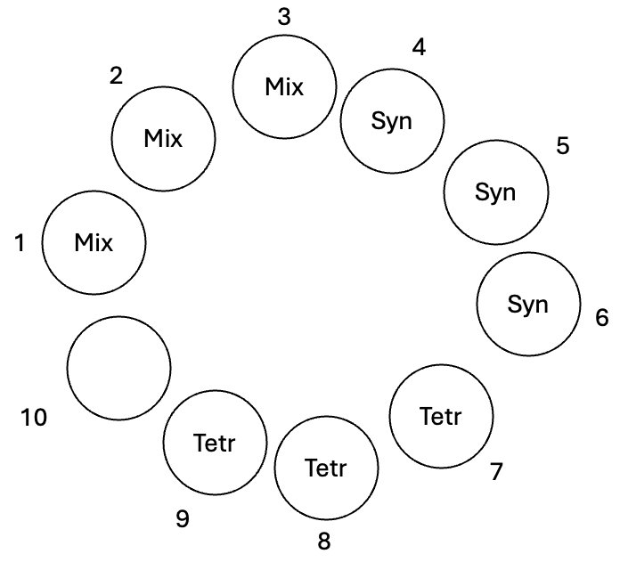

**Title:** Phytoplankton sample of day 0

**Date:** Wednesday 15th April 2026

**Aim:** Sampling the phytoplankton we are providing the Daphnia with.

**Material:**

| *Prepared* | *Amount* | *Material* | *Purpose* |
|----|----|----|----|
| ☐ | 1 | Mix of Tetradesmus + Synechococcus in <u>Zoo-COMBO</u> | To be sampled |
| ☐ | 1 | Tetradesmus in <u>Zoo-COMBO</u> | To be sampled |
| ☐ | 1 | Synechococcus in <u>Zoo-COMBO</u> | To be sampled |
| ☐ | 1 | Vacuum filtration pump | To pull phytoplankton through the GF/C filter |
| ☐ |  | Pre-combusted (2h in 550°C) GF/C filters (25mm)  | To capture the phytoplankton |
| ☐ | 2 | Forceps | To manipulate the filters |
| ☐ | 1 | 24-well plate | To store the filters to then be dried |
| ☐ | 1 | 96-well plate | To store the filters to then be analysed |
| ☐ | 1 | Pipette and tips | To pipette phytoplankton on filters |
| ☐ | 1 | Metal block | To wrap the aluminium foil around the filters |
| ☐ |  | Aluminium cartridges | To wrap the filters so that they can be already analysed |

**Steps:**

1.  Set up material.

    1.  Set up the vacuum filtration pump and connect its tube to the wall gas supply (the tube sucks air in, allowing the liquids to come more easily through the filter).

    2.  Add GF/C filters (<u>they should have been burnt at 550 °C for 2 hours</u>) on the filtration unit using <u>clean</u> <u>forceps</u> (cleaned with ethanol and fire – hold forceps horizontally while burning).

    3.  Add cylinder weights on top of the filters.

    4.  Turn on suction slowly, checking on the filtration unit that the pressure doesn’t exceed 0.2 bar.

2.  Add samples to the filters. For each of the samples:

    1.  Pipette culture on the filter (remember to mix well the sample, and make sure that the liquid goes through, otherwise adjust the tap until no liquid is left on top of the filter). <u>Write down how much volume you added to the filter in the below figure.</u>

1.  Move the filters to a 24-well plate. To do so, turn off the suction, take off the cylinder weights, and move filters to the 24-well plate with <u>clean forceps</u> (cleaned with ethanol and fire)[^1]. Place each sample in the plate position noted in the below table.

Syn

Syn

Syn

Tetr

Mix

Tetr

Tetr

Mix

<figure>

<figcaption>
Mix
</figcaption>
</figure>

2.  Clean. Put back cylinder weights and turn on suction. Then, clean meshes and cylinders by pouring ethanol and demineralised water on them.

3.  Place 24-well plate with filters inside in an oven at 50 °C overnight to dry.

*Pack filters (day after)*

For each filter (always using forceps), place an aluminium cartridge on one of the wells of the metal block, unwrapping it. Then, add to it a filter and wrap it into a small sphere, with a shape that is as round as possible. Add then the sphere into a well in the 96-well plate in the position described in the below table.

| **What**      | **Plate position** |
|---------------|--------------------|
| Mix           | A1                 |
| Mix           | A2                 |
| Mix           | A3                 |
| Synechococcus | A4                 |
| Synechococcus | A5                 |
| Synechococcus | A6                 |
| Tetradesmus   | A7                 |
| Tetradesmus   | A8                 |
| Tetradesmus   | A9                 |

[^1]: Lightly lift the filter by sliding one forceps arm underneath it. With the help of the other pair of forceps hold in place by lightly pressing on one point of the filter. Lift and push the filter with the pair that was underneath it, to fold in half. Fold in half again with the same technique. Now the filter is folded into a quarter of a circle.
